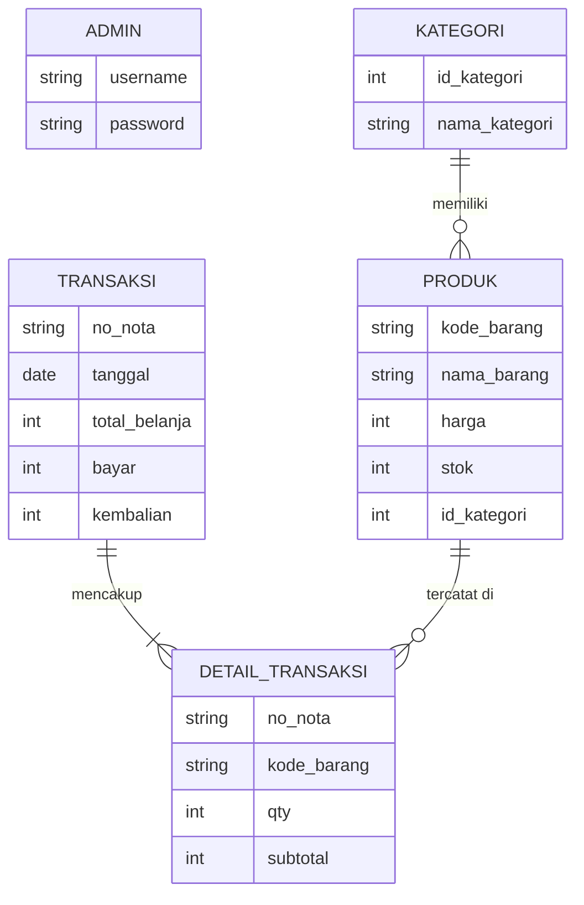

# PERANCANGAN SISTEM INFORMASI POINT OF SALES (POS) / KASIR TOKO

## 1. Topik Sistem Informasi
Sistem Point of Sales (POS / Kasir Toko)

## 2. Latar Belakang & Tujuan
Tugas ini bertujuan untuk membangun antarmuka Halaman Admin Panel dan Kasir yang responsif, interaktif, dan informatif menggunakan teknologi Client-Side (HTML5, CSS3, JavaScript Vanilla). Sistem ini dirancang untuk mempercepat proses transaksi di kasir serta mempermudah pengelolaan data barang (Data Master) dan pemantauan penjualan (Dashboard & Laporan).

## 3. Ketentuan Tema Visual (Estetika UI)
**Tema Terpilih: Glassmorphism**
Alasan: Glassmorphism memberikan kesan modern, futuristik, dan bersih. Dengan efek latar belakang transparan (blur/translucent), antarmuka kasir akan terlihat sangat premium dan tidak membosankan bagi kasir yang menatap layar berjam-jam.

## 4. Struktur Menu (Sidebar)
1. **Dashboard:** Ringkasan penjualan hari ini, grafik penjualan (Chart.js), dan produk terlaris.
2. **Transaksi Kasir:** Antarmuka utama untuk melakukan input pesanan, menghitung total belanja, diskon, dan kembalian.
3. **Data Master (Barang):** Pengelolaan stok barang (Tabel CRUD).
4. **Laporan:** Rekapitulasi transaksi dan fitur cetak struk/laporan.
5. **Logout:** Keluar dari sesi.

## 5. ER-D (Entity Relationship Diagram)
Meskipun sistem menggunakan *Mock Data* (JavaScript Arrays), struktur relasi logisnya dirancang sebagai berikut:



## 6. User Flow (Alur Pengguna)
1. **Login:** Admin/Kasir memasukkan username & password.
2. **Dashboard:** Setelah login, diarahkan ke Dashboard untuk melihat grafik statistik.
3. **Transaksi Kasir:** Kasir memilih menu transaksi, mengklik produk dari daftar (grid), produk otomatis masuk ke keranjang di sisi kanan. Kasir memasukkan uang bayar, klik "Proses Transaksi", lalu muncul modal kembalian.
4. **Data Master:** Admin dapat menambah, mengedit, dan menghapus barang dari tabel.
5. **Laporan:** Admin mencetak laporan penjualan (window.print).

## 7. Desain Sistem & Wireframing (Milestone 1)
Desain awal dilakukan menggunakan Figma dan Google Stitch.

**A. Link Project Figma (Design System & High Fidelity)**
> ![Preview Desain Figma]
> [Link Figma Saya] (https://www.figma.com/design/ff6CepBlkle4b7pkvT5jL8/Untitled?node-id=7-2&t=gWZozlB0NXr41bMY-1)

**B. Link Google Stitch (Low-Mid Fidelity Wireframe)**
> 
> [Link Stitch Saya] https://stitch.withgoogle.com/projects/14608197327819079289

## 8. Struktur Folder Proyek
```text
pos-kasir/
├── docs/
│   └── PERANCANGAN.md
├── assets/
│   ├── css/
│   │   └── style.css
│   ├── js/
│   │   └── script.js
│   └── img/
├── pages/
│   ├── dashboard.html
│   ├── kasir.html
│   ├── data-barang.html
│   └── laporan.html
└── index.html
```
